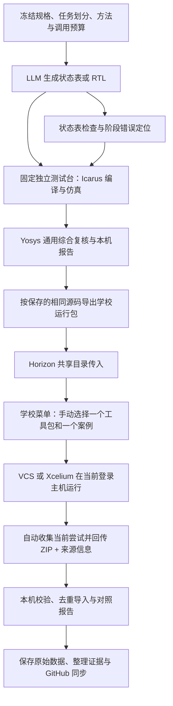

# XZY01：LLM 辅助数字电路设计——完整流程与阶段总结

> 2026-10-23 当前规则更正：本文是历史阶段记录，下列旧通过率及IR/反馈实验不得直接作为当前固定原题、单次直接RTL、独立RAG评测的正式结果。当前纳入/排除以 [实验纳入清单](validation/EXPERIMENT_ELIGIBILITY_20261023.md) 为准；不合规、工程校准及尚未核清的结果均移出当前主线统计。原始证据保留。

整理日期：2026-10-09。本文作为项目总入口；实际成绩来自已保存的实验与工具回传，不把运行包数量当成已完成仿真数量。

## 1. 当前完成到哪里

已建立可复现的本机研究工具链，并通过学校 Horizon 桌面完成一例 VCS 和 Xcelium 实际验收。已将 178 份历史 RTL 复验、整理成学校单案例菜单；菜单与自动回传已通过本机/WSL 测试，尚待学校首次实际使用。

| 项目 | 当前状态 |
|---|---|
| 规格 → LLM → RTL → Icarus → 结果汇总 | 已实现，保存提示词、RTL、退出码、日志与判定 |
| 正式开发集与两模型 pilot | 10 题开发集、60 次真实生成完成 |
| 状态表方法、执行检查与阶段错误定位 | 48 次可行性调用和 96 槽位配对修复实验完成 |
| 通用综合 | 历史 pilot/FSM/配对保存 RTL 已经 Yosys 复核；不等于 PPA 或签核 |
| 本机 → ECE → 商业仿真 → 本机 | 同一 FSM 在 Icarus/VCS/Xcelium 均通过 1840 次检查 |
| 历史 RTL 大规模复验 | 178/178 与原结果一致；不是新增模型样本 |
| 学校菜单与自动回传 | 已实现、离线测试通过；每次只运行用户选择的一例 |
| 扩大商业工具验证范围 | 已准备 356 个案例×工具项，尚未逐项完成 |
| 新一轮小模型实验 | 4 个槽位遇 HTTP 403，0 份有效输出，12 项仍未提交 |

## 2. 研究问题和证据边界

当前主线：**控制调用预算后，结构化状态表与可执行检查能否减少特定时序语义错误，并区分规格理解阶段和 RTL 实现阶段的错误？**

研究流程将“规格 → 状态表”和“状态表 → RTL”分开检查。规格图与候选状态表不一致而 RTL 忠实实现错误表时，可定位为规格到状态表错误；正确状态表被错误 RTL 实现时，可定位为状态表到 RTL 错误。两阶段同时偏离时保留 BOTH_DIVERGE 等分类，不强行归入单一阶段。这是对可观测产物的定位，不是模型内部思考过程的证明。

需要严格区分：端到端生成准确率、给定错误表后的条件修复效果、人工故障校准、仿真工具兼容性。它们不能合并成一个“方法提升百分比”。部分题族模型本来就全部通过，存在效果上限；当前证据不足以断言检查方法普遍优于基线。

相关文献、方法差异与贡献讨论见 [FSM_LITERATURE.md](FSM_LITERATURE.md)。正式贡献仍需独立最终测试题、明确消融与公平预算比较支持。

## 3. 已完成实验

| 实验 | 规模 | 主要结果 | 解读限制 |
|---|---|---|---|
| Dev10 pilot | 2 模型×10 题×3 次＝60 份 RTL | 两模型各 24/30 功能通过；60/60 通用综合通过 | 开发子集成绩，不是官方 benchmark 或总体模型正确率 |
| FSM 可行性 | 48 次调用，24 份 RTL；普通计划/状态表/状态表+检查 | 三组分别 7/8、7/8、8/8 功能通过；24/24 综合通过 | 检查组初始表全部正确，没有实际触发修复，不能据此证明反馈纠错增益 |
| 固定错误表配对修复 | A 32＋B 64＝96 槽位；94 份有效 RTL、2 次基础设施超时 | 89/94 功能通过、94/94 综合通过；42 对双方通过、5 对仅反馈通过、0 对仅控制通过、1 对缺失 | 条件修复实验；自然错误与注错分开；5 对集中在两题族，不是普遍优势或显著性证明 |
| FSM 故障校准 | 163 种单处故障、5 个正确参考、25 格定位校准 | 原公开检查漏检 30 种；开发内增强例子后覆盖 163/163；定位校准通过 | 增强例子拟合开发故障集，不是保留题泛化结果 |
| 历史 RTL 重放 | 60＋24＋94＝178 份 | 159 PASS、10 FUNCTION_FAIL、9 COMPILE_FAIL；178/178 与原始标签一致 | 重放没有新增模型生成或修复失败答案 |
| 学校真实工具验收 | 同一 FSM，一次有效 VCS 与一次有效 Xcelium 验收 | 两者退出 0，1840 检查、0 错误；源码哈希相同，与 Icarus 一致 | 只有一例，不代表全部题目跨工具等价 |

详细记录：

- [Pilot 结果](PILOT_FINDINGS.md)、[FSM 结果](FSM_FINDINGS.md)、[配对实验结果](PAIRED_FINDINGS.md)、[故障校准结果](MUTATION_FINDINGS.md)。
- [178 份 RTL 复验](evidence/ece-workflow-20261008/replay-summary.json)、[本轮故障复验](evidence/ece-workflow-20261008/mutation-summary.json)。
- [VCS 真实验收](evidence/ece-vcs-smoke-20261008/result.json)、[Xcelium 真实验收](evidence/ece-xcelium-smoke-20261008/result.json)。

## 4. 完整工作流



不同研究方法会使用不同的生成阶段；普通 RTL 基线不要求先生成状态表。状态表公开检查与独立私有评分测试分开，避免将评分答案泄漏进提示词。

## 5. 本机与学校环境

| 环境 | 用途与已确认配置 |
|---|---|
| 本机 Windows | Python 3.10+、Icarus、历史实验运行、打包、接收、报告 |
| WSL/Linux | Yosys 通用综合和 Linux 回归；不能代替学校商业许可证 |
| ECE 桌面 | Omnissa Horizon Client，入口 `vdi.ece.ust.hk`；本次主机 `ecelvd702`、CentOS 7 |
| VCS | X-2025.06-SP1；setup：`/usr/eelocal/synopsys/vcs-vx2025.06-sp1/.cshrc` |
| Xcelium | xrun 23.03-s004；setup：`/usr/eelocal/cadence/xcelium2303hf/.cshrc` |
| 本机共享目录 | `C:\Users\A\Documents\FYP\ECE-Transfer`，位于已共享的 FYP 文件夹中 |
| 学校共享挂载 | 本次确认家目录下 `tsclient` 可见；主机或学校配置变化后需要重新确认 |

仓库路径：`E:\Codex\2026-09-25\xzy01-using-llm-for-digital-chip-2\outputs\rtl-batch`。

学校规则：共享 VDI 不提供 SSH，不支持批量 EDA 仿真，没有 EDA 调度器；在当前登录主机手动运行单例。Ubuntu SLURM 集群不能作为本项目 VCS/Xcelium 的已支持执行环境。计算问题联系人为 `eehelp@ece.ust.hk`；脚本不会自动发送邮件。

## 6. 日常操作：最短入口

### 6.1 本机查看和准备任务

在仓库目录的 PowerShell 中执行：

```powershell
.\ece.ps1 history
```

详细案例 ID 保存在 `workflow/history.json`。目前已导出 10 个包：FSM48、paired-a32、paired-b64、pilot 的两个模型，各对应 VCS/Xcelium；178 份 RTL 共 356 个工具验证项。已有运行包无需再次 prepare。

新增或重打包具体案例时：

```powershell
.\ece.ps1 prepare --run-dir runs/paired-a32 --jobs m01__real_overlap__s001__control --backends vcs,xcelium
```

导出一份运行中的全部保留 RTL 供学校手动选择：

```powershell
.\ece.ps1 prepare --run-dir runs/paired-b64 --all-retained
```

prepare 只在本机复制/打包，不启动模型或 EDA。每次创建新的包和 nonce，更新学校目录菜单；重复 prepare 会新增验证项，不会复用旧包的商业结果。

### 6.2 学校打开菜单并运行一例

开启所需学校网络/VPN，登录 Horizon 的 ECE Linux 桌面，打开 Terminal，粘贴：

```bash
bash -c 'find "$HOME/tsclient" -maxdepth 6 -type f -name ece_menu.sh -exec bash {} \; -quit'
```

依次输入工具运行包编号、一个案例编号；输入 0 退出。环境 doctor 输出用于检查 setup/tcsh，不能单独证明许可证可用。

菜单自动完成复制到学校家目录的新会话、校验、单例运行、日志收集和回传。一次菜单最多执行一个仿真；不要用循环包裹它。每个尝试独立保存，默认超时 300 秒。执行完毕不等于功能通过，必须等待本机验收。

### 6.3 本机接收和查看结果

```powershell
.\ece.ps1 ingest
.\ece.ps1 status
```

结果入口：`workflow/report.html`、`workflow/status.csv`、`workflow/status.json`。ingest 自动读取共享目录 `inbox` 的新 ZIP/来源 JSON，重复 ZIP 跳过；每次尝试单独留档。退出码 0 表示导入有效，实际功能结果以报告 PASS/FAIL 为准。

历史真实验收是校准证据，不会自动填入新包分数。没有真实回传的 356 个项仍显示 NOT_RUN；它们不是已完成的 356 次商业仿真。

## 7. 脚本职责

| 文件 | 职责 |
|---|---|
| `batch.py` / `pilot.py` / `fsm_study.py` / `paired_study.py` | 原有生成、预算、实验计划与评分；沿用冻结版本 |
| `rtl_lab.py` / `backends.py` / `synthesis.py` | RTL 提取与独立仿真、后端、通用综合 |
| `ece.ps1` | 本机统一 PowerShell 入口；兼容旧 pack/stage/receive |
| `ece_workflow.py` | history/prepare/ingest/status，包注册、来源绑定、去重与报告 |
| `ece_transfer.py` / `school_bridge.py` | 校验原始源码、生成工具脚本、安全打包和导入 |
| `ece_menu.sh` / `ece_station.py` | 学校 Linux 菜单、选择一个包和一个案例、解压及启动 |
| `ece_desktop.py` | doctor/list/run/collect，以及 session 自动运行回传、ship 补传 |
| `ece_replay.py` | 复验历史 RTL，0 新模型调用，不改变历史标签 |
| `mutation_study.py` | 故障覆盖、定位校准、证据校验 |
| `start_ece.sh` / `start_xcelium.sh` | 之前已验证的单包准备入口，保留用于复现与排错 |
| `shutdown_native.ps1` | 有完成 receipt 才允许执行的 Windows 正常关机接口 |

具体菜单和异常操作见 [ECE_WORKFLOW.md](ECE_WORKFLOW.md)；之前的逐步学校验证记录见 [ECE_DESKTOP_GUIDE.md](ECE_DESKTOP_GUIDE.md)。

## 8. 判定、证据与异常处理

本机核对原始运行包哈希、案例来源、backend、nonce、源码与向量哈希、检查数量、工具退出码和日志。回传文件不是远程主机的密码学身份认证；保留完整日志以便复核。

| 状态/现象 | 处理方式 |
|---|---|
| PASS | 独立回执、检查数量、源码与退出码通过校验 |
| FUNCTION_FAIL | 独立测试发现功能不符；保留输出，不手工修复后冒充原成绩 |
| COMPILE_FAIL | 工具拒绝编译，须看日志区分代码问题和工具配置差异 |
| ENV_ERROR | setup、工具启动或许可证等环境问题，不能当作模型逻辑失败 |
| EVIDENCE_ERROR | 源码、来源或必要记录缺失/变化，结果不可信 |
| NOT_RUN | 没有可验收的回传结果，不算通过 |
| TIMEOUT/INTERRUPTED | 保留执行记录；新回传接口归入未正常完成的 SIM_ERROR，不算通过 |
| 共享目录不可写 | 当前尝试保留在学校 outbox，恢复共享后用 ship 补传，不重新仿真 |

补传命令：在对应学校运行包目录中执行，替换实际共享路径：

```bash
python3 ece_desktop.py ship --return-dir /实际共享路径/FYP/ECE-Transfer/inbox
```

先前解决的接口问题：tcsh 的相对脚本名导致 `$0:h` 无法定位目录，现使用绝对脚本路径；VCS 的 timescale 编译顺序问题，现先读取带声明的测试台；学校终端的 `$(...)` 不兼容问题，复杂 shell 命令明确交给 Bash。这些修复未改变验收案例的 RTL、测试台或向量。

## 9. 验证、保存与 GitHub

本轮 WSL 完整测试 **61/61 通过**，新增 Windows 菜单/回传测试 **13/13 通过**，GitHub CI `37797239020` 通过。Windows 完整套件的两个旧本地 HTTP mock 方法受系统代理影响，本地请求没有绕过代理；限制已记录，未修改系统代理或冻结实验运行代码。

| 位置 | 保存内容 |
|---|---|
| `runs/` | 原始生成、调用、逐项测试与运行结果；本机保留 |
| `evidence/` | 经过整理并锁定的实验和验收证据；提交 GitHub |
| `workflow/packages/` + `workflow/registry.json` | 原始学校包、nonce、哈希和映射；必须留存 |
| `workflow/returns/` | 每次真实回传的解压证据和导入报告 |
| 学校 `~/xzy01-ece/` | 每次运行的学校会话、results 与 outbox |
| 共享目录 `inbox/` | 自动回传 ZIP 与来源 JSON |
| `validation/ece-workflow-completion/` | 完成 receipt、归档清单、关机状态 |

归档文件：`workflow-backup.zip`（工作台）、`offline-revalidation-raw.zip`（本轮复验）、`source-final.zip`（完成时源码快照）；SHA256 见同目录 `archives.json`。源码快照是 2026-10-08 完成时版本，不自动包含后续文档更新。

GitHub 私有仓库：[Maxnopnop/xzy01-rtl-lab](https://github.com/Maxnopnop/xzy01-rtl-lab)。代码、指南和整理证据已同步；原始运行、工作台 registry/nonce 和 ZIP 不会因克隆代码自动恢复。换电脑须恢复这些本机数据并调整路径，不能丢弃原包后只凭回传 ZIP 重新计分。

关机记录：2026-10-08 23:06:49（北京时间），Windows `ExitWindowsEx` 调用记录为 NORMAL_NATIVE_SHUTDOWN_REQUESTED、win32_error=0、force=false。此记录证明请求被接受，不单独证明实际断电。默认脚本仅检查权限，日常 history/prepare/ingest/status 不自动触发关机。

## 10. 接下来按什么顺序推进

1. **学校首次使用新菜单与自动回传**：每套工具各选择一例，确认无需手填 attempt 即可进入本机报告。旧单例链路已通过，新菜单真实使用仍待验收。
2. **扩大代表性商业工具验证**：先复验复位、输出时机、握手/延迟、计数器和编译兼容性样本，再手动逐例扩大。特别检查 Icarus 编译失败而 Yosys 接受的历史 RTL；不能预先假定商业工具一定通过。
3. **解决模型服务 403**：与学校许可证问题分开排查。原计划 16 槽位中已预留 4、有效输出 0；剩余 12 尚未提交，不无条件重跑未知/失败调用。
4. **完善正式研究评估**：独立最终题目、保留集隔离、明确方法与消融、公平调用/Token 预算；自然错误、注错、基础设施失败和重复生成分开报告。
5. **完成协作复现与 FYP 写作**：让队友独立重放并记录验收；结合文献说明贡献和限制。当前还没有工艺库 PPA、形式等价或芯片签核结果。

**现在的结论：本机研究工具链和一例学校商业工具验证已跑通，历史复验和可扩展运输工具已完成；正式方法结论、扩大商业覆盖与新菜单实机验收仍需继续。**
